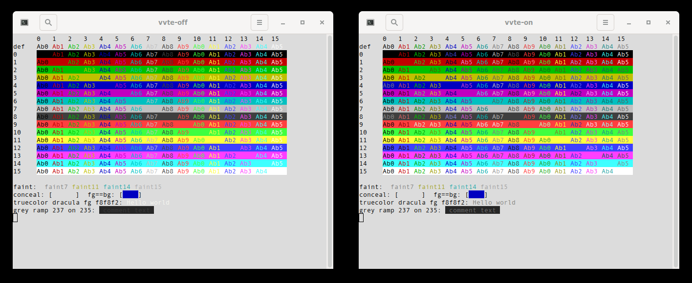

# xfce4-terminal and VTE: readable colours, braille-capable default font

Development repository for two changes to the mariux64 packages
`vte-0.84.1-1` and `xfce4-terminal-1.1.5-1` (see `vte.be0` and
`xfce4-terminal.be0`, as committed in bee-files):

- **Minimum contrast (VTE).** Text whose WCAG 2 contrast ratio against its
  background is below 3.0 (white on light grey, dark blue on black, yellow on
  grey, …) is drawn lighter or darker, keeping its hue. Only the drawing
  changes: normal text, selection, the character under the cursor and
  input-method text; the colours applications chose stay as they are. Text
  deliberately hidden with the same text and background colour is left alone,
  and dim text gets half the margin. On by default for every VTE terminal,
  GTK 3 and GTK 4. The ratio is the property `VteTerminal:minimum-contrast`
  (1.0 = off) or `VTE_MINIMUM_CONTRAST` in the environment.
- **View → Minimum Contrast (xfce4-terminal).** A menu item (also in the
  context menu's *View Options*) and the saved preference
  `misc-minimum-contrast`, default on. It is shown only if VTE has the
  property above.
- **Hack Braille as the default font (xfce4-terminal).** Hack 3.003 plus the
  braille patterns U+2800–U+28FF, which TUIs such as btop use for graphs and
  which most monospace fonts lack. All four styles are compiled in and
  registered with fontconfig from memory at startup; nothing is installed.
  A font set in the preferences still wins.

The same changes exist for xterm (`minimumContrast` resource, embedded Hack
Braille); Hack Braille itself is made by `mkhackbraille.py` from that work.

## Layout

| Path | Content |
|---|---|
| `vte-0.84.1/` | VTE sources, with history: upstream import, bee patch, our commits |
| `xfce4-terminal-1.1.5/` | xfce4-terminal sources, the same way |
| `*.patch` | The patches the bee files apply, as stored in md5repo |
| `vte.be0`, `xfce4-terminal.be0` | The bee files |
| `screenshots/` | Test screenshots |

The patches are `git diff`s of the two source trees: `vte-0.84.1-min-contrast.patch`
from the "bee:" commit to the top of `vte-0.84.1/`;
`xfce4-terminal-1.1.5-embedded-font.patch` and
`xfce4-terminal-1.1.5-minimum-contrast-toggle.patch` from the "bee:" commit,
one commit each.

## Sources

Not in this repository; fetched from beehive (md5 in the URL):

- [vte-0.84.1.tar.xz](https://beehive.molgen.mpg.de/ea4e16dbba54a6b8ba2cbb95cfdaa217/vte-0.84.1.tar.xz)
- [xfce4-terminal-1.1.5.tar.xz](https://beehive.molgen.mpg.de/d779b64ead82330b6bbc7d500f542490/xfce4-terminal-1.1.5.tar.xz)
- [hack-braille-3.003.tar.gz](https://beehive.molgen.mpg.de/9d3164696416dac1787155b809fd6787/hack-braille-3.003.tar.gz):
  the four Hack Braille TTFs, licence, README and generator. Unpack it into
  `xfce4-terminal-1.1.5/` before building xfce4-terminal.

VTE's bundled subprojects (`fast_float`, `fmt`, `simdutf`) are in the
repository as plain files, without the `.git` directories the tarball ships.

## Building and testing

VTE (meson; GTK 3 only is enough for xfce4-terminal):

    meson setup build-vte vte-0.84.1 --buildtype=debugoptimized \
        -Dgtk4=false -Dgir=false -Dvapi=false -Dglade=false -Ddocs=false \
        --force-fallback-for=fast_float,simdutf --wrap-mode=nofallback
    ninja -C build-vte

xfce4-terminal is built in its source directory through `autogen.sh`, as bee
does (this also turns on maintainer mode, which the man page needs):

    curl -fsSLO https://beehive.molgen.mpg.de/9d3164696416dac1787155b809fd6787/hack-braille-3.003.tar.gz
    cd xfce4-terminal-1.1.5
    tar xzf ../hack-braille-3.003.tar.gz
    ./autogen.sh --prefix=/usr --disable-nls
    make

Run it against the new VTE, isolated from a running xfce4-terminal and from
the user's settings:

    dbus-run-session -- env XDG_CONFIG_HOME=$(mktemp -d) \
        LD_LIBRARY_PATH=$PWD/../build-vte/src \
        terminal/xfce4-terminal --disable-server

## Licences

VTE: mostly LGPL 3, parts GPL 3 and others (see `vte-0.84.1/COPYING.README`);
the bundled subprojects carry their own licences. xfce4-terminal:
GPL-2.0-or-later (`xfce4-terminal-1.1.5/COPYING`). Hack Braille: as Hack,
MIT and the Bitstream Vera License (in the font tarball). The changes here
are under the licence of the project they change.
